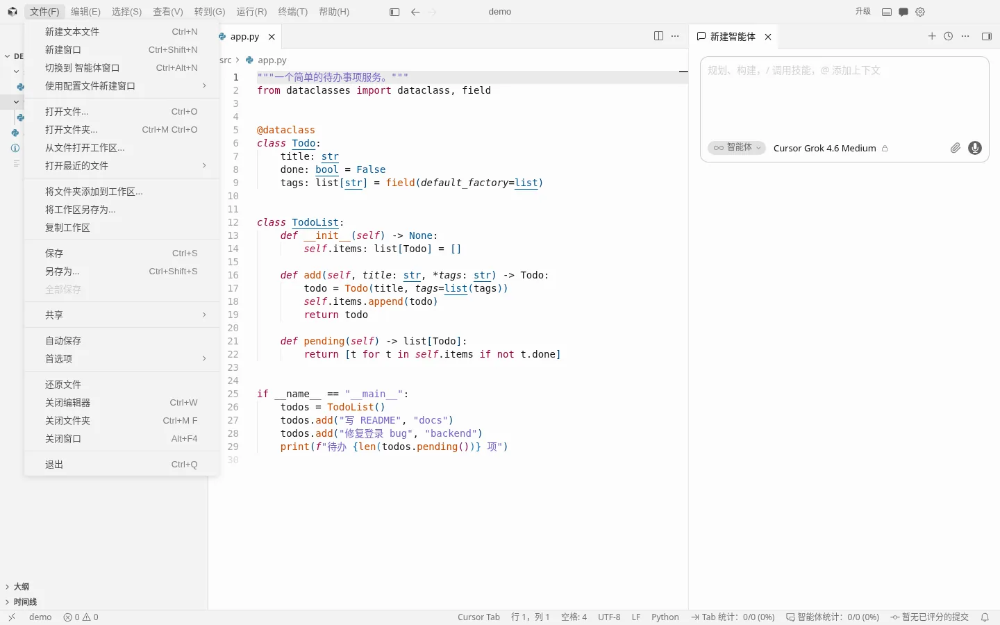
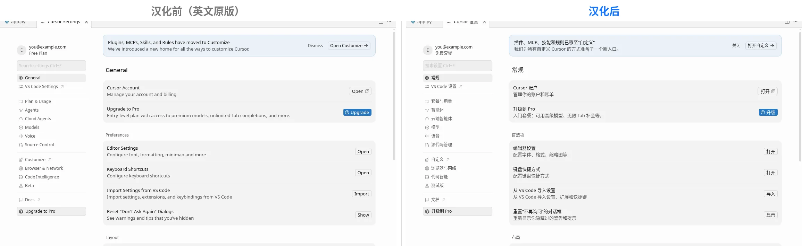
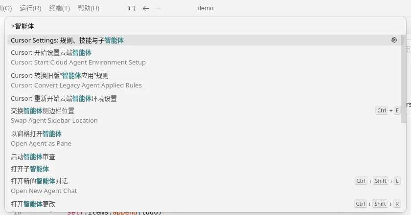
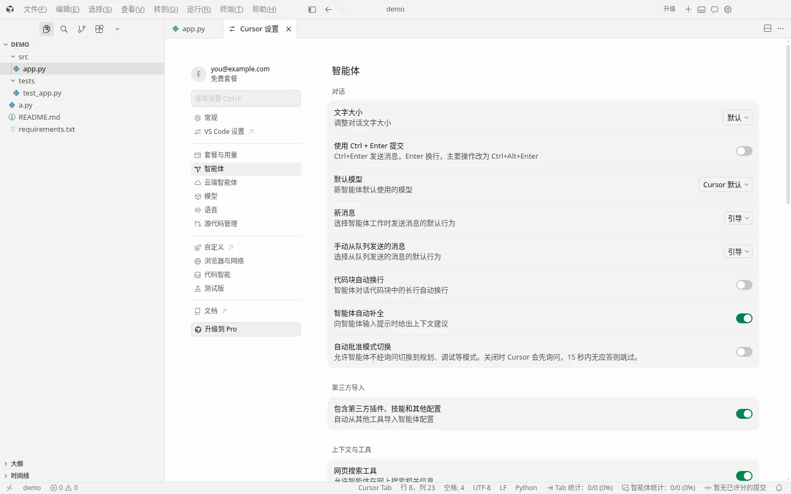
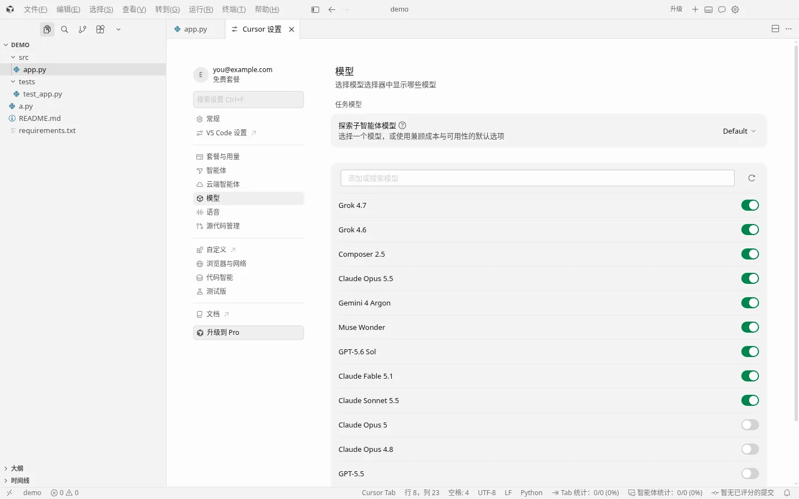
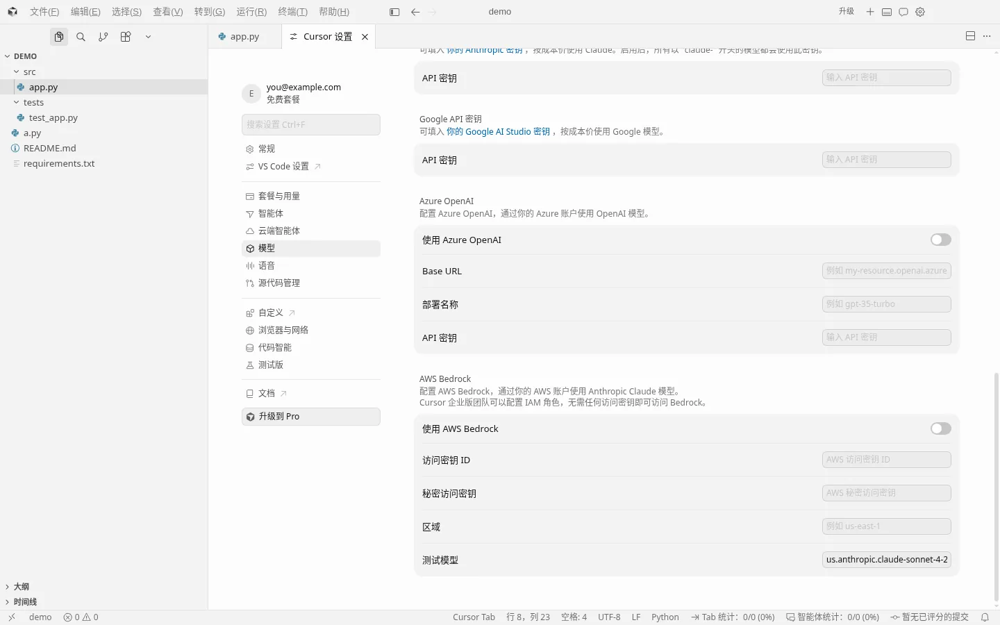
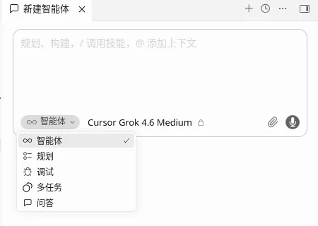
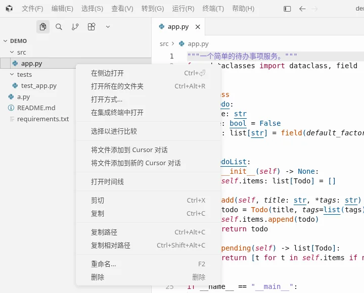
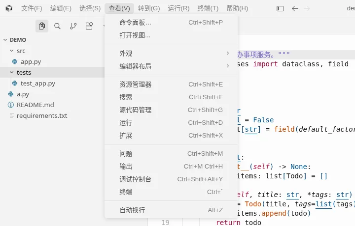
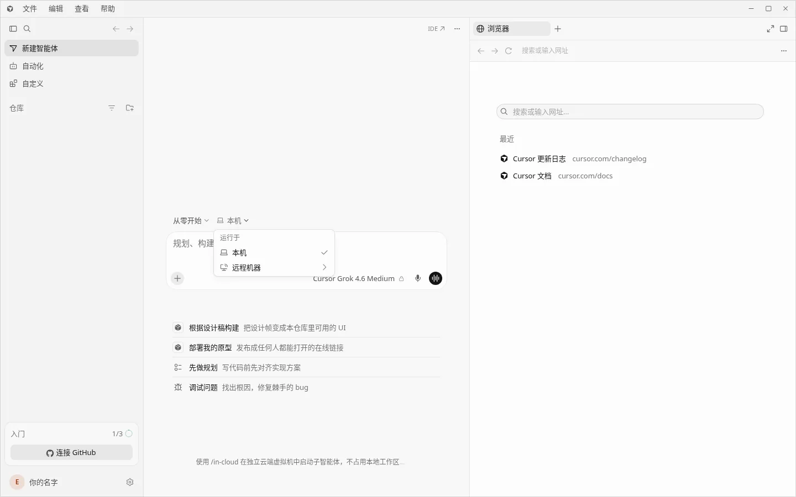

<div align="center">


# YXY · Cursor 一键汉化

**把 Cursor 的菜单、设置、命令面板和 Agent 界面换成简体中文。**  
一点汉化，一点还原。由 **YXY** 维护。

[](LICENSE)
[](#-下载安装)
[](#支持哪些-cursor-版本)

[下载](#-下载安装) · [使用步骤](#-使用步骤) · [常见问题](#-常见问题) · [反馈](https://github.com/mym20060307-a11y/cursor-zh-YXY/issues)

</div>



## 特点

- **一键汉化 / 一键还原**：修改前自动备份；还原后与原版逐字节一致。
- **只翻界面**：不碰你的代码、文件名、AI 对话内容；不收集、不上传数据。
- **品牌名保留英文**：Cursor、Claude、GPT、Grok 等专有名词不硬翻。
- **Cursor 升级后可再点一次**：更新会覆盖汉化文件，重新汉化即可。
- **词典可在线更新**：联网时拉取本仓库最新词典；离线则用安装包内置词典。

## 功能覆盖（概览）

| 区域 | 说明 |
|---|---|
| 菜单栏 / 右键菜单 | 文件、编辑、查看、Agents 窗口菜单等 |
| 命令面板 | Cursor / VS Code 命令文案 |
| Cursor 设置 | 常规、套餐与用量、智能体、模型、Profile 等 |
| Agent / Chat | 模式、提示、常用按钮 |

<details>
<summary><b>更多 Cursor 界面截图</b></summary>













 



</details>

## 下载安装

到 [Releases](https://github.com/mym20060307-a11y/cursor-zh-YXY/releases) 下载对应系统的包：

| 系统 | 文件 |
|---|---|
| **Windows** 10/11 x64 | `cursor-zh-*-win-x64-portable.exe`（免安装）或 setup / cli 包 |
| **macOS** | dmg / app.zip |
| **Linux** | deb / AppImage |

### 首次打开的安全提示

本工具暂未购买代码签名证书，系统可能拦截：

- **Windows**：SmartScreen → **更多信息 → 仍要运行**
- **macOS**：右键打开，或到 **系统设置 → 隐私与安全性** 选择仍要打开；也可：

  ```bash
  xattr -dr com.apple.quarantine "/Applications/Cursor 一键汉化.app"
  ```

## 使用步骤

1. 打开 **YXY · Cursor 一键汉化**，确认检测到的安装路径与版本。
2. 点 **一键汉化**。若 Cursor 正在运行，按提示关闭后再写入。
3. 看到完成提示后重启 Cursor（若工具未自动拉起）。

想换回英文：点 **一键还原**。

> 只有「写入 Cursor 安装目录」可能需要管理员权限（UAC / 系统授权）。工具界面本身以普通用户运行。

## 常见问题

### Cursor 更新后又变回英文？

正常。打开本工具点 **重新汉化 / 更新汉化** 即可。

### 支持哪些 Cursor 版本？

已提供锚点：`3.24.18`、`3.27.14`、`3.27.22`、`3.28.7`。更新版本可用兼容模式（能翻则翻，未匹配处保持英文）。版本见 Cursor：**帮助 → 关于**。

### 会不会弄坏 Cursor？会不会影响 AI？

不会改功能逻辑，只替换界面文案。不满意随时一键还原；备份在数据目录的 `backups/` 下，勿删。

### 日志在哪里？

| 系统 | 位置 |
|---|---|
| Windows | `%APPDATA%\cursor-zh-localizer` |
| macOS | `~/Library/Application Support/cursor-zh-localizer` |
| Linux | `~/.config/cursor-zh-localizer` |

窗口内可点 **打开日志**。

## 反馈

问题与建议请到 [Issues](https://github.com/mym20060307-a11y/cursor-zh-YXY/issues)，请附上系统、Cursor 版本、截图和 `gui.log`。

## 免责声明

- 本项目由 **YXY** 维护，**与 Cursor（Anysphere Inc.）官方无关**。
- 会修改本机 Cursor 安装文件（自动备份、可还原）。请自行评估风险。

## 许可证

[MIT](LICENSE) · © 2026 YXY

内置微软 [简体中文语言包](https://github.com/microsoft/vscode-loc) 说明见 [THIRD_PARTY_NOTICES.md](THIRD_PARTY_NOTICES.md)。

---

开发文档：[docs/DEVELOPMENT.md](docs/DEVELOPMENT.md)
